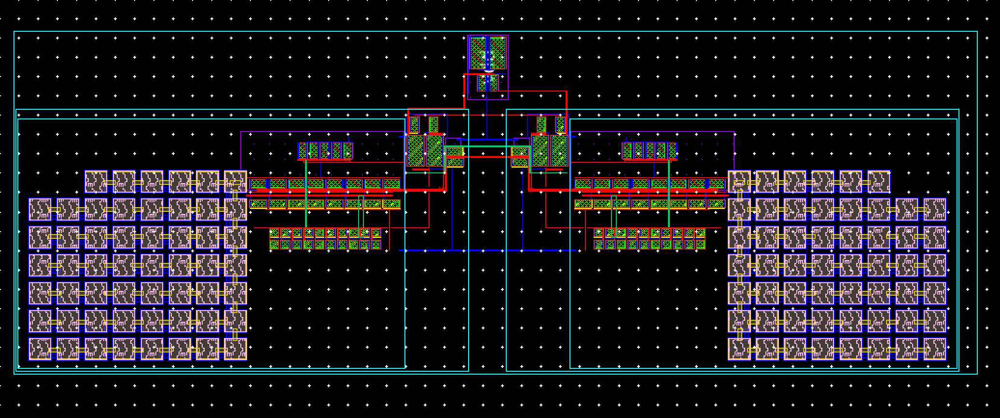
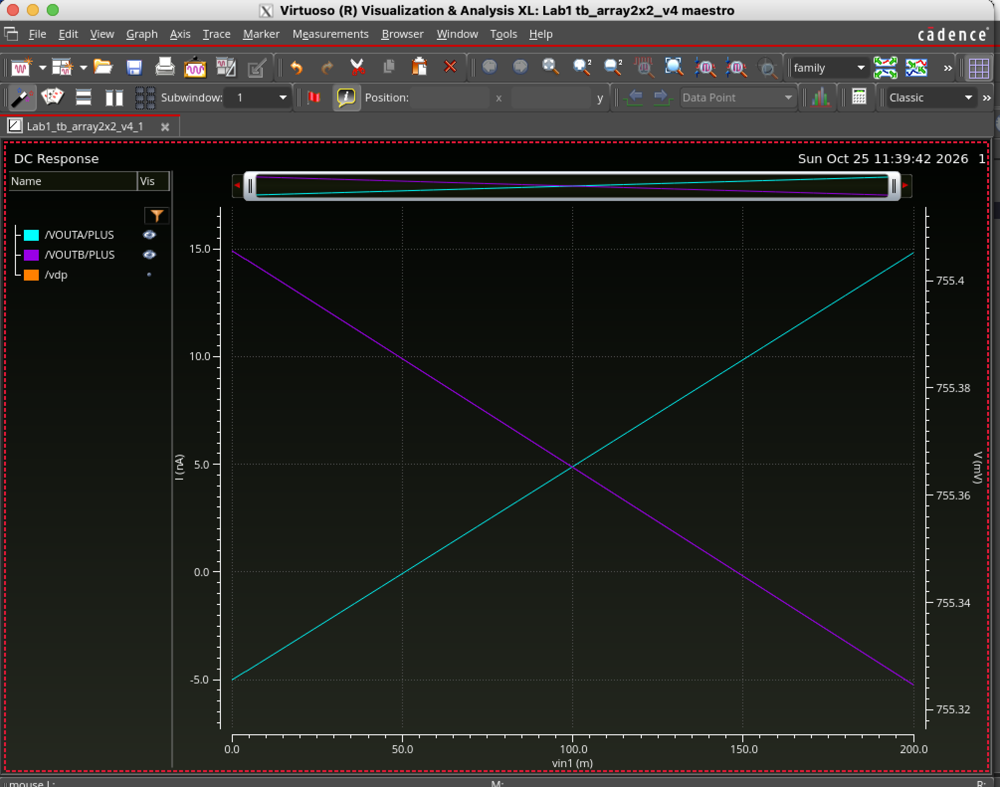

# Subthreshold Differential Memristor Crossbar: Analog Compute-in-Memory MAC

A full-custom, 45nm analog compute-in-memory (CIM) engine designed and verified in Cadence Virtuoso. By storing neural network weights as differential memristor pairs, the circuit performs hardware-level multiply-accumulate (MAC) operations using physics. The input voltages on the wordlines generate a dot-product current down the bitlines. To safely capture these ultra-low signals, I designed and laid out a custom subthreshold, virtual-ground readout circuit, validating the entire system through post-layout parasitic extraction.


> Multiplication by Ohm's law, addition by Kirchhoff's current law, no data movement.

**Status:** readout periphery fully laid out, **DRC clean, LVS matched, PEX extracted**, and the 2×2 differential array re-verified post-layout to within **~10 pA** of schematic. Next: 9×3 image-classifier demo (see [Roadmap](#roadmap)).

<!-- TODO(Marc): hero image here: annotated colout3 layout -->


---

## What it does
What it does
The array does a multiply-and-add in one step, using only physics:

Multiply (Ohm's law). Each input is a voltage on a wordline. Each memristor's conductance G is a stored weight. The current through a cell is input × G.
Add (Kirchhoff's law). All cells on a bitline share one wire, so their currents add up on their own.
Read without disturbing. The readout holds each bitline at 300 mV while copying its current out, so every cell sees exactly its input.
Signed weights. A conductance can't be negative, so each weight is a pair: G⁺ on one bitline, G⁻ on its partner. A current mirror subtracts them, giving w = G⁺ − G⁻.
Each column outputs Σ (input × weight): one dot product, the core operation of a neural-network layer.

How the crossbar computes

**The math.** One bitline adds up its cells, and each column subtracts its pair of bitlines:

$$
I_{BL} = \sum_i G_i \, V_i
$$

$$
I_{out} = I_{BL^+} - I_{BL^-} = \sum_i \left( G_i^{+} - G_i^{-} \right) V_i = \sum_i w_i \, V_i
$$

where $V_i$ is the voltage on wordline $i$ and $w_i = G_i^{+} - G_i^{-}$ is the signed weight.
,,,

## Architecture

| Cell | What it is | Key details |
|---|---|---|
| `ota3` | Two-stage Miller OTA | PMOS input pair 8u/4u, NMOS load 8u/4u, 2nd stage 40u/2u; 2 pF MIM Miller cap (54 units); ~20 nA tail |
| `readout4` | Bitline clamp + current copier | OTA holds BL at `ref` (300 mV) by driving an NMOS cascode mirror (8u/4u + 4u/2u cascode); a **MOS resistor** (replica-biased, ≈9 MΩ) damps the bitline node |
| `colout3` | Differential column output | Two `readout4` + PMOS self-biased cascode mirror; `sum = I(blp) − I(bln)` |
| Memristor | Simplified VTEAM, Verilog-A ([vteam.va](veriloga/vteam.va)) | Threshold + power-law state drift, R linear in state (2–50 MΩ), no window function; read-only below ±0.7 V. States 5 / 10 / 20 MΩ (xinit 0.0625 / 0.16667 / 0.375) |

Biasing: vdd = 1 V, vref = 300 mV, vcas = 400 mV, iref = 20 nA into a diode PMOS (vdp ≈ 755 mV). Supply current ≈ 120 nA per readout (~0.12 µW at 1 V).

### Schematics and layouts

| Cell | Schematic | Layout |
|---|---|---|
| `ota3` | [schematic](docs/images/ota3_schematic.png) | [layout](docs/images/ota3_layout.png) |
| `readout4` | [schematic](docs/images/readout4_schematic.png) | [layout](docs/images/readout4_layout.png) · [clamp + MOS resistor detail](docs/images/readout4_layout_zoom_clamp_bias.png) |
| `colout3` | [schematic](docs/images/colout3_schematic.png) | [layout](docs/images/colout3_layout.png) · [PMOS mirror detail](docs/images/colout3_layout_zoom_pmos_mirror.png) |
| 2×2 array testbench | [schematic](docs/images/tb_array2x2_v4_schematic.png) | n/a (behavioural memristors) |

## Verification

### Post-layout DC: 2×2 differential array (colout3 = Quantus extracted view)

DC sweep of vin1 with vin2 = 100 mV. Ideal outputs are −5 / 5 / 15 nA (A) and 15 / 5 / −5 nA (B).

| vin1 | A post-layout | A schematic | B post-layout | B schematic |
|---|---|---|---|---|
| 0 mV | −5.028 nA | −5.031 nA | 14.932 nA | 14.931 nA |
| 100 mV | 4.888 nA | 4.886 nA | 4.860 nA | 4.858 nA |
| 200 mV | 14.821 nA | 14.81 nA | −5.240 nA | −5.242 nA |

Worst schematic-to-layout difference: **11 pA**. Supply sensitivity (0.9–1.1 V): 0.157 / 0.191 nA, unchanged from schematic.



### Golden-model check

`scripts/golden_model.py` computes the ideal Σ V·(G⁺ − G⁻) for any weight matrix and checks simulated outputs against it. On the post-layout 2×2 results:

```
$ python3 scripts/golden_model.py --weights "2,-2;-1,3" --check tests/tb_array2x2_v4_postlayout.csv
vin=[0.0, 0.1] out1: sim   -5.028 nA  ideal   -5.000 nA  error   -28.2 pA  PASS
vin=[0.0, 0.1] out2: sim  +14.932 nA  ideal  +15.000 nA  error   -68.0 pA  PASS
vin=[0.1, 0.1] out1: sim   +4.888 nA  ideal   +5.000 nA  error  -112.3 pA  PASS
vin=[0.1, 0.1] out2: sim   +4.860 nA  ideal   +5.000 nA  error  -139.8 pA  PASS
vin=[0.2, 0.1] out1: sim  +14.821 nA  ideal  +15.000 nA  error  -179.5 pA  PASS
vin=[0.2, 0.1] out2: sim   -5.240 nA  ideal   -5.000 nA  error  -239.7 pA  PASS
ALL PASS
```

Worst error against ideal math is 0.24 nA (1.6% of the 15 nA full scale), inside the 0.5 nA limit set by Monte Carlo mismatch (σ ≈ 0.43 nA).

### Robustness (schematic)

| Check | Result |
|---|---|
| Monte Carlo mismatch σ | ≈ 0.43 nA per output |
| Temperature 0–85 °C | ≈ 0.2 nA drift |
| Supply 0.9–1.1 V | ≈ 0.16–0.19 nA drift |

### Transient stability (readout4, schematic and post-layout)

| Case | Bitline load | Step | Settling (post-layout) |
|---|---|---|---|
| Easy | 1 pF / 50 MΩ | ~1 nA | ~2 ms ([plot](docs/images/tran_easy_postlayout.png)) |
| Long bitline | 10 pF / 50 MΩ | ~1 nA | ~3 ms, same as schematic ([plot](docs/images/tran_long_bitline_postlayout.png)) |
| Hard | 10 pF / 5 MΩ | ~10 nA | ~2.8 ms, schematic 2.5–3.5 ms ([plot](docs/images/tran_hard_postlayout.png)) |

Bitline held at 300 mV in every case; parasitics did not change loop behaviour.

### Physical verification

`colout3` is the top cell and contains every `readout4` and `ota3`, so its runs cover the whole hierarchy: [DRC 0 of 562](docs/images/drc_colout3_clean.png) · [LVS match](docs/images/lvs_colout3_match.png).

| Cell | DRC (PVS, 562 rules) | LVS (PVS) | PEX (Quantus, C-only coupled) |
|---|---|---|---|
| `ota3` | clean | match | via readout4 |
| `readout4` | clean | match | extracted, transients re-run |
| `colout3` | clean | match | extracted, array DC re-run |

## Layout

<!-- TODO(Marc): confirm overall size with a ruler; my estimate from the screenshot is ~250 × 90 µm -->

- **Matching:** OTA input pair and load mirror interleaved `ABBAABBA` (common centroid, 4.92 µm pitch); bias ratio 1:4 built from identical unit devices (`BBABB`), so the ratio is set by counting.
- **MIM caps:** 2 pF per OTA as an 8×7 array between Metal10/Metal11. The top plate goes to the sensitive high-impedance node, the bottom plate to the low-impedance output.
- **Low-parasitic routing:** Metal2 horizontal, Metal3 vertical; bias lines kept away from the high-impedance nodes (bitlines, mirror gates, `sum`).
- **Hierarchy:** `colout3` mirrors its two `readout4` so the mirror stacks face a shared PMOS cascode mirror at the centre; the caps sit on the outer edges.

## Design notes

Full story, including every bug LVS caught: [docs/design_log.md](docs/design_log.md).

- **Why a virtual ground:** if the bitline floats it rises with current, every cell's voltage shrinks, and the multiply goes nonlinear. The readout exists to pin the bitline while measuring the current into it.
- **An ideal resistor isn't buildable:** a 10 MΩ poly resistor would need ~4,900 µm². The damping resistor became a replica-biased MOS transistor (R = U_T / I), and it damps about 3× more steadily over temperature than a fixed resistor would.
- **Subthreshold sizing:** in this kit, current scales almost linearly with W but only as **L^−0.4** (reverse short-channel effect), so width is the reliable sizing knob.
- **DRC passes wrong circuits:** LVS caught every real bug: a floating n-well, a split diff-pair finger, a same-layer crossing that shorted the OTA gate to ground. DRC caught none of them.

## Limitations

- **Memristors are behavioural** (VTEAM Verilog-A): no variability, no read nonlinearity, no retention, weights fixed by initial state. gpdk045 has no RRAM layers, so only the CMOS periphery is laid out. In a real process the cells sit in the back end, above the wordline/bitline crossings.
- Biases (iref, vref, vcas) and wordline drivers are external/ideal.
- Slow by design: ms-scale settling at nA currents, roughly hundreds of inferences per second. This is a µW-class demonstration, not a throughput claim.

## Next steps
  The following are:[] 
- [ ] 9×3 differential crossbar (54 memristors) classifying 3×3-pixel images (X, +, O)
- [ ] Tileable column cell and multi-column readout macro layout
- [ ] On-chip bias generation (remove external references)

## Repository structure

```
.
├── README.md
├── images/          headline layout and simulation plots
├── docs/            design log, schematics, layouts, DRC/LVS, transients
├── scripts/
│   ├── crossbar.py        weight ↔ memristor-state mapping, ideal outputs
│   ├── gen_array.py       weight matrix → Spectre netlist (any N×M)
│   ├── golden_model.py    ideal outputs and pass/fail check
│   └── run_regression.sh  generate, simulate, check
├── tests/           reference results (schematic and post-layout)
├── netlists/        colout3 subcircuit, Quantus-extracted (post-layout)
└── veriloga/        VTEAM memristor model
```

**Weights.** Each weight is an integer from −3 to +3 in units of 0.05 µS, stored as a G⁺/G⁻ pair drawn from three states (5, 10, 20 MΩ). Rows are separated by `;`, columns by `,`.

```bash
python3 scripts/golden_model.py --weights "2,-2;-1,3" --vin "0,0.1"     # ideal outputs
python3 scripts/gen_array.py --weights "2,-2;-1,3" --vin "0,0.1" \
    --colout3 netlists/colout3_extracted.scs > tb.scs                              # Spectre netlist
scripts/run_regression.sh                                                # simulate + check
```

Cadence views and gpdk045 model files are not included (licensed). The netlists, model and scripts reproduce the results with Spectre and any gpdk045 install.

## References

- S. Kvatinsky et al., "VTEAM: A General Model for Voltage-Controlled Memristors," IEEE TCAS-II, 2015.
- Cadence gpdk045 Generic Process Design Kit.
- Background: analog in-memory computing with resistive crossbars (e.g. Ielmini & Wong, "In-memory computing with resistive switching devices," Nature Electronics, 2018).

## Author

Marc Arnault, undergraduate, Chapman University.
