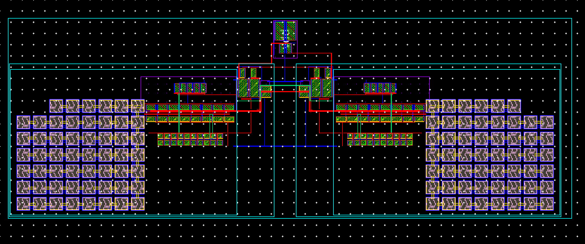
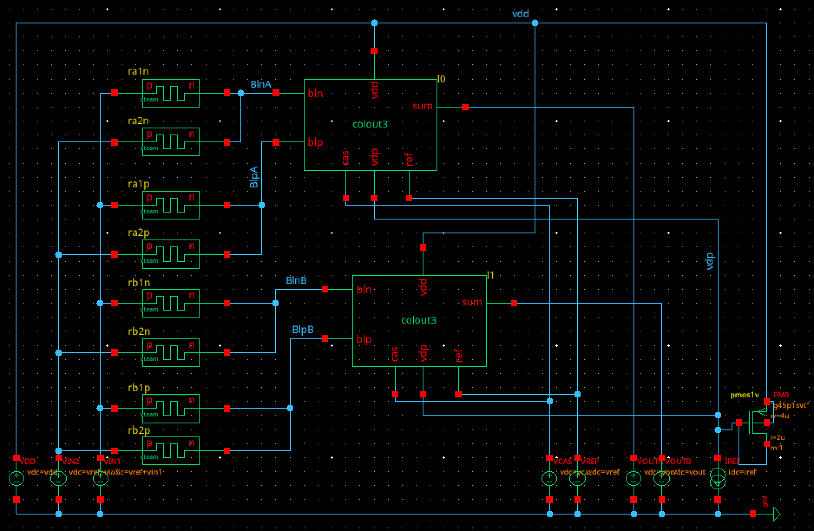
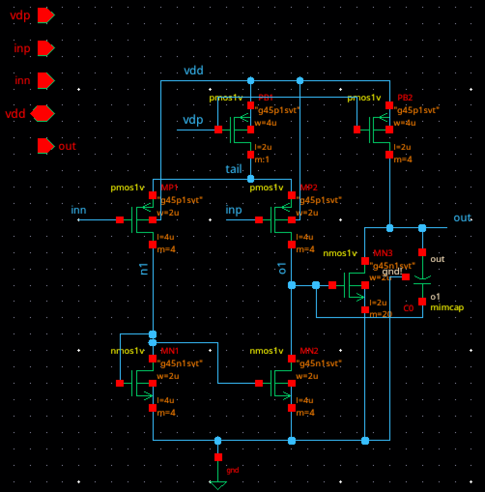
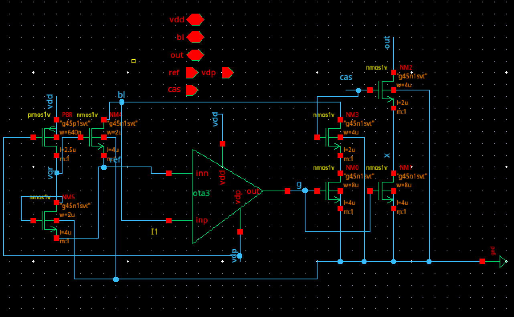
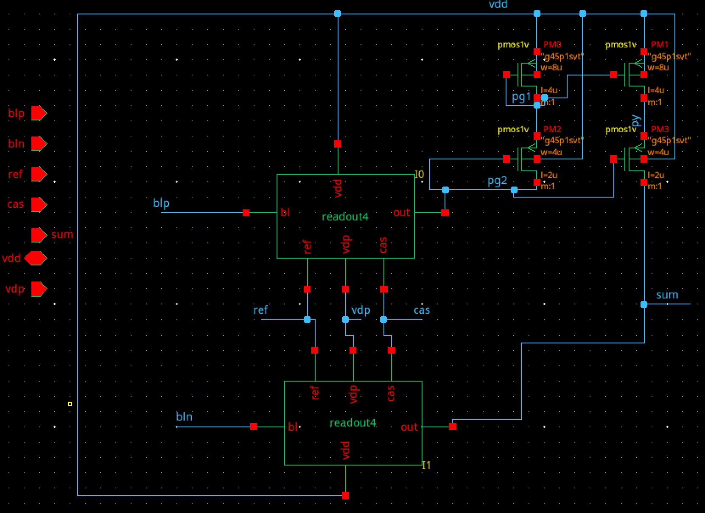
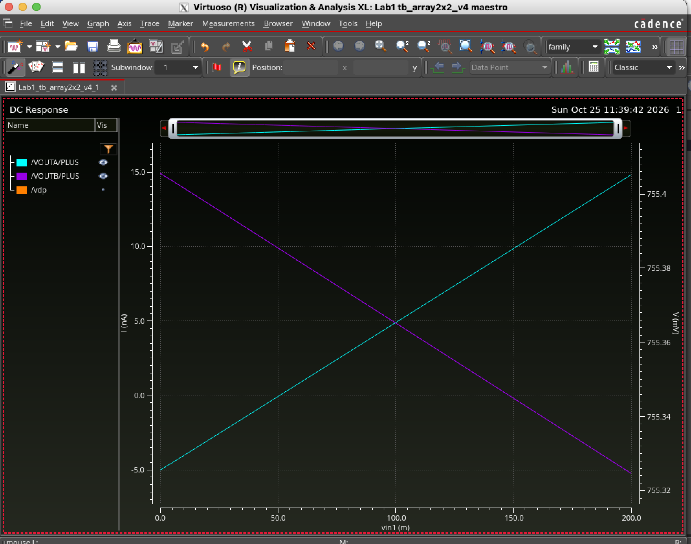

# Subthreshold Differential Memristor Crossbar: Analog Compute-in-Memory MAC

A full-custom, 45 nm analog compute-in-memory (CIM) engine designed and verified in Cadence Virtuoso. By storing neural-network weights as differential memristor pairs, the circuit performs multiply-accumulate (MAC) operations in the analog domain, inside the memory array: the input voltages on the wordlines generate a dot-product current down the bitlines. To capture these nanoamp-level signals, I designed and laid out a custom subthreshold, virtual-ground readout circuit and verified it with post-layout parasitic extraction.

> Multiplication by Ohm's law, addition by Kirchhoff's current law, with the weights never leaving the array.

**Status:** readout periphery fully laid out, **DRC clean, LVS matched, PEX extracted**, and the 2×2 differential array re-verified post-layout to within **11 pA** of schematic. Next: 9×3 image-classifier demo (see [Next steps](#next-steps)).



### Key results

| Metric | Result |
|---|---|
| Array demonstrated | 2×2 signed weights = 8 memristors, 2 differential columns |
| Readout area | 249 × 89 µm (0.022 mm²) per differential column |
| Readout power | ≈ 0.24 µW per column at zero input (2 × 120 nA at 1 V); excludes signal current, bias generation and wordline drivers |
| Accuracy (post-layout) | worst error 0.05 LSB (1 LSB = 5 nA); schematic-to-layout within 11 pA |
| Settling | ~2–3 ms, schematic and post-layout; phase margin 20° under heavy bitline load, ~90% output-current overshoot (see [Limitations](#limitations)) |
| Physical verification | DRC clean (PVS, no violations), LVS matched, Quantus PEX extracted |

---

## What it does

The array does a multiply-and-add in one step, in the analog domain:

1. **Multiply (Ohm's law).** Each input is a voltage on a wordline. Each memristor's conductance G is a stored weight. The current through a cell is input × G.
2. **Add (Kirchhoff's law).** All cells on a bitline share one wire, so their currents add up on their own.
3. **Read without disturbing.** The readout holds each bitline at 300 mV while copying its current out, so every cell sees exactly its input.
4. **Signed weights.** A conductance can't be negative, so each weight is a pair: G⁺ on one bitline, G⁻ on its partner. A current mirror subtracts them, giving w = G⁺ − G⁻.

Each column outputs Σ (input × weight): one dot product, the core operation of a neural-network layer.



*The 2×2 testbench in Virtuoso: two wordline inputs, eight VTEAM memristors forming four G⁺/G⁻ weight pairs, and one `colout3` readout per column.*

**The math.** One bitline adds up its cells, and each column subtracts its pair of bitlines:

$$
I_{BL} = \sum_i G_i \, V_i
$$

$$
I_{out} = I_{BL^+} - I_{BL^-} = \sum_i \left( G_i^{+} - G_i^{-} \right) V_i = \sum_i w_i \, V_i
$$

where $V_i = V_{WL,i} - V_{ref}$ is the input on wordline $i$ (the cell voltage, with the bitline held at $V_{ref}$) and $w_i = G_i^{+} - G_i^{-}$ is the signed weight.

## Architecture

| Cell | What it is | Details |
|---|---|---|
| `ota3` | Two-stage Miller OTA | PMOS input pair 8u/4u, NMOS load 8u/4u, 2nd stage 40u/2u; 2 pF MIM Miller cap (54 units); ~20 nA tail |
| `readout4` | Bitline clamp + current copier | OTA holds BL at `ref` (300 mV) by driving an NMOS cascode mirror (8u/4u + 4u/2u cascode); a **MOS resistor** (replica-biased, ≈9 MΩ) damps the bitline node |
| `colout3` | Differential column output | Two `readout4` + PMOS self-biased cascode mirror; `sum = I(blp) − I(bln)` |
| Memristor | Simplified VTEAM, Verilog-A ([vteam.va](veriloga/vteam.va)) | Threshold + power-law state drift, R linear in state (2–50 MΩ), no window function; read-only below ±0.7 V. States 5 / 10 / 20 MΩ (xinit 0.0625 / 0.16667 / 0.375) |

Device sizes are W/L in µm (8u/4u = 8 µm wide, 4 µm long). The number in each cell name (`ota3`, `readout4`, `colout3`, `tb_array2x2_v4`) is its design revision in my Cadence library.

**Inputs are unipolar.** Each wordline sits at vref + vin with vin ≥ 0, because the readout's NMOS mirror can only sink bitline current; a negative net bitline current would cut it off and the clamp would lose the bitline. Signed results come from the G⁺/G⁻ pair, not from signed inputs. Tested range: 0–200 mV. That is the spec. 0.7 V is a hard ceiling, not an operating range: it is the VTEAM switching threshold, where a read would start to change the stored weight. Linearity of the clamp at larger bitline currents has not been shown.

Biasing: vdd = 1 V, vref = 300 mV, vcas = 400 mV, iref = 20 nA into a diode PMOS (vdp ≈ 755 mV). Supply current ≈ 120 nA per readout, so ≈ 0.24 µW per differential column at 1 V.

### Schematics and layouts

| Cell | Schematic | Layout |
|---|---|---|
| `ota3` | [schematic](docs/images/ota3_schematic.png) | [layout](docs/images/ota3_layout.png) |
| `readout4` | [schematic](docs/images/readout4_schematic.png) | [layout](docs/images/readout4_layout.png) · [clamp + MOS resistor detail](docs/images/readout4_layout_zoom_clamp_bias.png) |
| `colout3` | [schematic](docs/images/colout3_schematic.png) | [layout](docs/images/colout3_layout.png) · [PMOS mirror detail](docs/images/colout3_layout_zoom_pmos_mirror.png) |
| 2×2 array testbench | [schematic](docs/images/tb_array2x2_v4_schematic.png) | n/a (behavioural memristors) |

<p align="center">
  
  
  
</p>

*Left to right: `ota3` (two-stage Miller OTA), `readout4` (bitline clamp and current copier), `colout3` (two `readout4` and the PMOS subtracting mirror). Click any image for full size.*

## Verification

### Post-layout DC accuracy: 2×2 differential array

DC sweep of vin1 with vin2 = 100 mV, `colout3` as its Quantus-extracted view. Weights are `2,-2;-1,3` (units of 0.05 µS). Error is post-layout minus ideal.

| vin1 | Column | Ideal | Schematic | Post-layout | Error |
|---|---|---|---|---|---|
| 0 mV | A | −5.000 nA | −5.031 nA | −5.028 nA | −28 pA |
| 0 mV | B | 15.000 nA | 14.931 nA | 14.932 nA | −68 pA |
| 100 mV | A | 5.000 nA | 4.886 nA | 4.888 nA | −112 pA |
| 100 mV | B | 5.000 nA | 4.858 nA | 4.860 nA | −140 pA |
| 200 mV | A | 15.000 nA | 14.810 nA | 14.821 nA | −180 pA |
| 200 mV | B | −5.000 nA | −5.242 nA | −5.240 nA | −240 pA |

Worst schematic-to-layout difference: **11 pA**. Supply sensitivity (0.9–1.1 V): 0.157 / 0.191 nA, unchanged from schematic.



The ideal column comes from `scripts/golden_model.py`, which computes Σ V·(G⁺ − G⁻) for any weight matrix and checks simulated outputs against it.

<details>
<summary>Golden-model output</summary>

```
$ python3 scripts/golden_model.py --weights "2,-2;-1,3" --check tests/tb_array2x2_v4_postlayout.csv
vin=[0.0, 0.1] out1: sim   -5.028 nA  ideal   -5.000 nA  error   -28.2 pA  PASS
vin=[0.0, 0.1] out2: sim  +14.932 nA  ideal  +15.000 nA  error   -68.0 pA  PASS
vin=[0.1, 0.1] out1: sim   +4.888 nA  ideal   +5.000 nA  error  -112.3 pA  PASS
vin=[0.1, 0.1] out2: sim   +4.860 nA  ideal   +5.000 nA  error  -139.8 pA  PASS
vin=[0.2, 0.1] out1: sim  +14.821 nA  ideal  +15.000 nA  error  -179.5 pA  PASS
vin=[0.2, 0.1] out2: sim   -5.240 nA  ideal   -5.000 nA  error  -239.7 pA  PASS
ALL PASS
```

`out1` is column A, `out2` is column B.
</details>

**Accuracy in LSBs.** One weight unit at 100 mV is 0.05 µS × 100 mV = 5 nA (1 LSB). The worst error is 0.24 nA = **0.05 LSB** (1.6% of the largest tested output, 15 nA); the pass limit is 0.1 LSB (0.5 nA). Monte Carlo mismatch σ is 0.43 nA ≈ 0.09 LSB, so random mismatch sets the precision, not this error.

**The error is systematic and tracks common-mode current.** In both columns, whether the output rises or falls, the errors fit error ≈ −0.26% × (I(BL⁺) + I(BL⁻)) to within 19 pA (column totals are 15/45/75 nA for A and 25/55/85 nA for B). The subtraction leaks about 0.26% of the column's total current. The likely cause is a copy-ratio mismatch between the two readout paths: one drives the PMOS mirror diode, the other drives the output node, so their output $V_{DS}$ differ. A zero-weight test confirms it ([plot](docs/images/zero_weight_cm_test.png)): with every cell at 5 MΩ, so G⁺ = G⁻ everywhere and the ideal output is exactly 0, both columns read about −0.13 / −0.24 / −0.36 nA at total column currents of 40 / 80 / 120 nA (vin1 = 0 / 100 / 200 mV, vin2 = 100 mV). That is a leak of about 0.3% of the common-mode current, close to the 0.26% fitted from the weighted data. It matters for the 9-row classifier, whose columns carry several times more common-mode current.

### Robustness (schematic, CMOS periphery only)

| Check | Result |
|---|---|
| Monte Carlo mismatch σ | ≈ 0.43 nA per output |
| Temperature 0–85 °C | ≈ 0.2 nA drift |
| Supply 0.9–1.1 V | ≈ 0.16–0.19 nA drift |

The memristor model has no variability or temperature dependence, so these numbers describe the CMOS readout only. Real RRAM conductance spread (often 5–20%) would dominate.

### Transient stability (readout4, schematic and post-layout)

| Case | Bitline load | Step | Settling, schematic | Settling, post-layout |
|---|---|---|---|---|
| Easy | 1 pF / 50 MΩ | ~1 nA | ~2 ms | ~2 ms ([plot](docs/images/tran_easy_postlayout.png)) |
| Long bitline | 10 pF / 50 MΩ | ~1 nA | ~3 ms | ~3 ms ([plot](docs/images/tran_long_bitline_postlayout.png)) |
| Hard | 10 pF / 5 MΩ | ~10 nA | 2.5–3.5 ms | ~2.8 ms ([plot](docs/images/tran_hard_postlayout.png)) |

Settling times are read from the plots by eye, not measured to a formal tolerance. The bitline voltage stays within a few mV of 300 mV in every case; the overshoot is on the **output current**. In the hard case a 10 nA step overshoots by about 90% (a spike to ≈ −29 nA on the way from −10 to −20 nA) and rings for about 10 cycles. Post-layout settling matches schematic.

**Loop stability (stb).** A loop-gain analysis at the hard-case load (cbl = 10 pF, rsyn = 5 MΩ, 10 nA bitline current) confirms a low phase margin: **20° at a 10.9 kHz unity-gain frequency**, with about 52 dB of loop gain at low frequency. The loop phase starts at 180° and has fallen to 20° where the gain crosses 0 dB ([plot](docs/images/stb_hard_case.png)). For a second-order loop, 20° corresponds to a damping ratio of about 0.18 and roughly 55% overshoot; the larger 90% seen in the transient is a single narrow spike, probably fast feedthrough on top of the loop response. The same small-signal model predicts ringing at about 11 kHz (≈ 90 µs period) that dies out in about 0.3 ms, which matches the fast ringing right after the step. The full 2–3 ms settling is longer because a 10 nA step on a 10 nA bias is a large signal: the OTA output must slew. Its slew rate is about I_tail / C_c = 20 nA / 2 pF = 10 mV/ms, and doubling the mirror current takes $n U_T \ln 2 \approx 22$ mV of gate swing, so about 2 ms. Small-signal phase margin sets the ringing; slewing sets the settling time.

### Physical verification

`colout3` is the top cell and contains every `readout4` and `ota3`, so its runs cover the whole hierarchy: [DRC clean](docs/images/drc_colout3_clean.png) · [LVS match](docs/images/lvs_colout3_match.png).

| Cell | DRC (PVS) | LVS (PVS) | PEX (Quantus, C-only coupled) |
|---|---|---|---|
| `ota3` | clean | match | via readout4 |
| `readout4` | clean | match | extracted, transients re-run |
| `colout3` | clean | match | extracted, array DC re-run |

## Layout

- **Size:** `colout3` (one differential column, two readout channels) is 249 × 89 µm, about 0.022 mm².
- **Matching:** OTA input pair and load mirror interleaved `ABBAABBA` (common centroid, 4.92 µm pitch); bias ratio 1:4 built from identical unit devices (`BBABB`), so the ratio is set by counting.
- **MIM caps:** 2 pF per OTA from 54 unit caps (5.555 µm square) in an 8-wide grid, 6 full rows plus a top row of 6, between Metal10 and Metal11. The top plate goes to the sensitive high-impedance node, the bottom plate to the low-impedance output.
- **Low-parasitic routing:** Metal2 horizontal, Metal3 vertical; bias lines kept away from the high-impedance nodes (bitlines, mirror gates, `sum`).
- **Hierarchy:** `colout3` mirrors its two `readout4` so the mirror stacks face a shared PMOS cascode mirror at the centre; the caps sit on the outer edges.

## Design notes

Full story, including every bug LVS caught: [docs/design_log.md](docs/design_log.md).

- **Why a virtual ground:** if the bitline floats it rises with current, every cell's voltage shrinks, and the multiply goes nonlinear. The readout exists to pin the bitline while measuring the current into it.
- **An ideal resistor isn't buildable, and a MOS one is better:** for a 10 MΩ poly resistor, we would need ~4,900 µm², so the damper became a replica-biased MOS transistor. In subthreshold the OTA's $g_m \propto I/U_T$ while the MOS resistor's $R \propto U_T/I$, and both currents come from the same reference, so $g_m R$, which sets the damping, is temperature-independent to first order. Over 0–85 °C, $g_m R$ drifts −8%, against −24% for a fixed resistor.
- **Subthreshold sizing:** in this kit, current scales almost linearly with W but only as $L^{-0.4}$ (reverse short-channel effect), so width is the reliable sizing knob.
- **DRC passes wrong circuits:** every connectivity bug I hit (a floating n-well, a split diff-pair finger, a same-layer crossing that shorted the OTA gate to ground) was DRC-clean. LVS caught all of them.

## Limitations

- **Memristors are behavioural** (VTEAM Verilog-A): Memristors have no variability, no read nonlinearity, no retention and the weights are fixed by the initial state. gpdk045 has no RRAM layers, so only the CMOS periphery is laid out. During the real process the cells sit in the back end, above the wordline/bitline crossings.
- **Low phase margin under heavy load:** the hard transient case (10 pF / 5 MΩ bitline, 10 nA step) overshoots ~90% on the output current and rings for ~10 cycles. stb gives a 20° phase margin at nominal conditions, which is below the usual 45–60° target. The circuit settles, but Monte Carlo and process corners have not been checked for this case, so stability across corners is not demonstrated.
- Biases (iref, vref, vcas), wordline drivers and the output termination are ideal: in the testbench an ideal 500 mV source holds each `sum` node, and the output compliance range has not been characterised yet.
- Slow by design: ms-scale settling at nA currents, roughly hundreds of inferences per second. This is a µW-class demonstration, not a throughput claim.

## Next steps

I'm working toward these improvements:

- 9×3 differential crossbar (54 memristors) classifying 3×3-pixel images (X, +, O)
- Tileable column cell and multi-column readout macro layout
- On-chip bias generation (remove external references)
- Stability: raise the hard-case phase margin above 45° (larger Miller cap or added damping), then Monte Carlo and corner checks
- Characterisation: output compliance range, clamp linearity above 60 nA per bitline, and reducing the 0.3% common-mode leak

## Repository structure

```
.
├── README.md
├── docs/            design log and all images (schematics, layouts, DRC/LVS, plots)
├── scripts/
│   ├── crossbar.py        weight ↔ memristor-state mapping, ideal outputs
│   ├── gen_array.py       weight matrix → Spectre netlist (any N×M)
│   ├── golden_model.py    ideal outputs and pass/fail check
│   └── run_regression.sh  generate, simulate, check
├── tests/           reference results (schematic and post-layout)
├── netlists/        colout3 subcircuit, Quantus-extracted (post-layout)
└── veriloga/        VTEAM memristor model
```

## Reproducing the results

**Weights.** Each weight is an integer from −3 to +3 in units of 0.05 µS, stored as a G⁺/G⁻ pair drawn from three states (5, 10, 20 MΩ). Rows are separated by `;`, columns by `,`.

```bash
# ideal outputs
python3 scripts/golden_model.py --weights "2,-2;-1,3" --vin "0,0.1"

# Spectre netlist for any weight matrix
python3 scripts/gen_array.py --weights "2,-2;-1,3" --vin "0,0.1" \
    --colout3 netlists/colout3_extracted.scs > tb.scs

# generate, simulate and check every test pattern
scripts/run_regression.sh
```

Cadence views and gpdk045 model files are not included (licensed). The netlists, model and scripts reproduce the results with Spectre and any gpdk045 install.

## References

- S. Kvatinsky et al., "VTEAM: A General Model for Voltage-Controlled Memristors," IEEE TCAS-II, 2015.
- Cadence gpdk045 Generic Process Design Kit.
- Background: analog in-memory computing with resistive crossbars (e.g. Ielmini & Wong, "In-memory computing with resistive switching devices," Nature Electronics, 2018).

## License

MIT, see [LICENSE](LICENSE).

## Author

Marc Arnault, undergraduate, Chapman University · [LinkedIn](https://www.linkedin.com/in/marc-arnault-45b765303)
